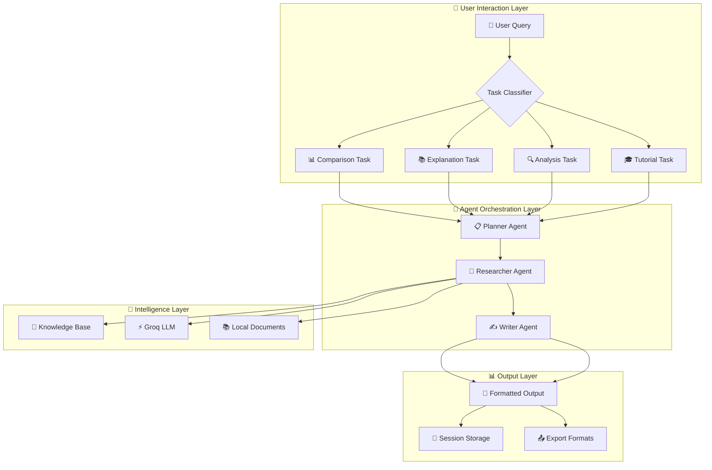
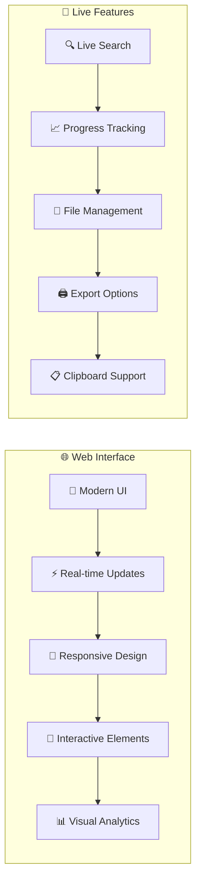
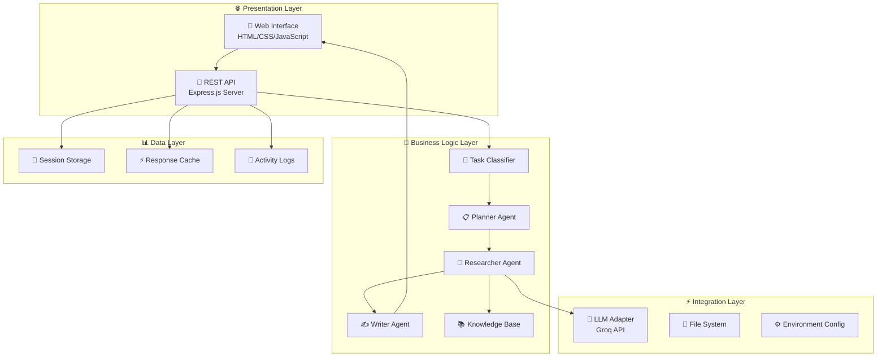
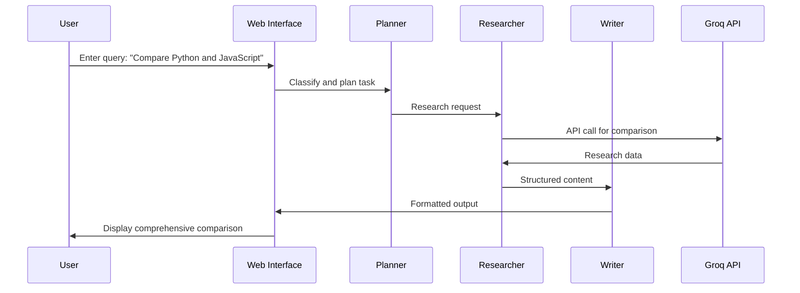

# 🤖 NuVora AI Multi-Agent System


**Intelligent Agent Collaboration for Advanced Research & Analysis**

**🚀 Quick Start** • **🏗️ Architecture** • **📚 Documentation** • **[🎮 Demo](#-live-demo)** • **🤝 Contributing**

## 📋 Table of Contents
1. [✨ Overview](#-overview)
2. [🚀 Key Features](#-key-features)
3. [🏗️ System Architecture](#️-system-architecture)
4. [📦 Core Components](#-core-components)
5. [⚡ Quick Start](#-quick-start)
6. [🎮 Usage Guide](#-usage-guide)
7. [🔧 API Integration](#-api-integration)
8. [📁 Project Structure](#-project-structure)
9. [🧪 Testing & Debugging](#-testing--debugging)
10. [🔍 Performance & Scaling](#-performance--scaling)
11. [🛡️ Security & Privacy](#️-security--privacy)
12. [🤝 Contributing](#-contributing)
13. [📄 License](#-license)
14. [🙏 Acknowledgments](#-acknowledgments)

## ✨ Overview

**NuVora AI** is a sophisticated multi-agent system that orchestrates intelligent AI agents to perform complex research, analysis, and content generation tasks. Built with modern JavaScript and powered by cutting-edge LLMs, it transforms simple queries into comprehensive, well-structured reports through a collaborative agent pipeline.

### System Flow Diagram



*Figure 1: NuVora AI Processing Pipeline*

### Key Innovations
- **Agent Collaboration**: Three specialized agents work in concert to deliver superior results
- **Context-Aware Processing**: Adapts response depth based on query complexity
- **Multi-format Generation**: Produces content in Markdown, HTML, and PDF formats
- **Session Management**: Organizes research into logical, searchable sessions

## 🚀 Key Features

### 🤖 **Intelligent Agent Pipeline**

| **📋 Planner Agent** | **🔎 Researcher Agent** | **✍️ Writer Agent** |
|---------------------|------------------------|---------------------|
| Analyzes task requirements | Conducts multi-source research | Structures content logically |
| Creates execution strategies | Validates information accuracy | Applies formatting standards |
| Defines output structure | Extracts key insights | Optimizes for readability |
| Allocates resources | Builds knowledge context | Generates multiple outputs |

### 🎯 **Advanced Capabilities**

#### ✅ **Smart Task Classification**
```
├── Comparison: "Compare Python vs JavaScript"
├── Explanation: "Explain blockchain technology"
├── Tutorial: "How to implement neural networks"
├── Analysis: "Analyze market trends in AI"
└── Definition: "What is quantum computing?"
```

#### ✅ **Multi-format Output**
```
├── 📄 Markdown (for notes)
├── 🌐 HTML (for web display)
├── 📊 PDF (for reports)
└── 📱 Responsive design
```

#### ✅ **Session Management**
```
├── Multiple concurrent sessions
├── Full history tracking
├── Export/import capability
└── Search and filter
```

### 💻 **Modern Web Interface**



*Figure 2: Web Interface Architecture*

## 🏗️ System Architecture



*Figure 3: Complete System Architecture*

### **Component Interactions**
```javascript
// High-level system flow
User Input → Task Classifier → Planner → Researcher → Writer → Output
                        ↓           ↓          ↓          ↓       ↓
                    Categorize  Strategy   Research   Format   Deliver
                    Query Type   Plan       Data      Content   Results
```

## 📦 Core Components

### **🤖 Agent System**

| Component | Purpose | Key Methods |
|-----------|---------|-------------|
| **`llmAdapter.js`** | Manages LLM connections | `callLLM()`, `testConnection()`, `checkAPIStatus()` |
| **`researcher.js`** | Conducts research | `conductResearch()`, `getAIResponse()`, `extractTopics()` |
| **`writer.js`** | Formats output | `generateOutput()`, `formatAIOutput()`, `markdownToHTML()` |
| **`planner.js`** | Creates plans | `createPlan()`, `customizePlan()` |
| **`task-classifier.js`** | Classifies tasks | `classifyTask()`, `extractTopics()`, `getConfidence()` |

### **🧠 Intelligence Layer**
```javascript
// Knowledge Base Structure
{
  "Merge Sort": {
    definition: "Divide-and-conquer sorting algorithm",
    keyPoints: ["O(n log n) complexity", "Stable sort", "Not in-place"],
    complexity: { time: "O(n log n)", space: "O(n)" },
    applications: ["External sorting", "Large datasets"]
  }
}
```

### **🌐 User Interface**
- **`app.js`**: Frontend application with real-time updates
- **`index.html`**: Modern, responsive web interface
- **`styles.css`**: Professional styling with animations

## ⚡ Quick Start

### **Prerequisites**
```bash
# System Requirements
✓ Node.js 18.x or higher
✓ npm 8.x or higher
✓ Groq API account (free)
```

### **Installation Steps**
```bash
# 1. Clone the repository
git clone https://github.com/yourusername/nuvora-ai.git
cd nuvora-ai

# 2. Install dependencies
npm install

# 3. Configure environment
cp .env.example .env
# Edit .env with your Groq API key

# 4. Start the server
npm start

# 5. Access the application
# Open browser to: http://localhost:3333
```

### **Environment Configuration**
```env
# .env file
PORT=3333
GROQ_API_KEY=your_groq_api_key_here
GROQ_MODEL=llama-3.1-8b-instant
```

### **Available Models**

| Model | Best For | Speed | Context |
|-------|----------|-------|---------|
| llama-3.1-8b-instant | Fast responses | ⚡⚡⚡⚡⚡ | 8K tokens |
| llama-3.1-70b-versatile | Complex tasks | ⚡⚡ | 8K tokens |
| mixtral-8x7b-32768 | Long documents | ⚡⚡⚡ | 32K tokens |
| gemma2-9b-it | Balanced use | ⚡⚡⚡⚡ | 8K tokens |

## 🎮 Usage Guide

### **Basic Workflow**



*Figure 4: User Query Processing Sequence*

### **Example Queries**
```
# 🎯 Comparison Tasks
• "Compare Merge Sort vs Quick Sort algorithms"
• "Python vs JavaScript for web development"
• "React vs Vue vs Angular frameworks"

# 📚 Explanation Tasks  
• "Explain blockchain technology in simple terms"
• "What is machine learning and how does it work?"
• "Describe the concept of quantum entanglement"

# 🔍 Analysis Tasks
• "Analyze the impact of AI on job markets"
• "Study the pros and cons of microservices"
• "Evaluate different database systems"

# 🎓 Tutorial Tasks
• "How to build a REST API with Node.js"
• "Step-by-step guide to neural networks"
• "Tutorial on using Docker containers"
```

### **Session Management**
```javascript
// Session Operations
const session = {
  id: "session_123",
  name: "AI Research Project",
  tasks: [
    {id: 1, query: "Compare ML algorithms", status: "completed"},
    {id: 2, query: "Explain neural networks", status: "processing"}
  ],
  created: "2026-01-15T10:30:00Z",
  lastActivity: "2026-01-15T14:45:00Z"
};
```

## 🔧 API Integration

### **REST API Endpoints**
```
# Task Management
POST   /api/task           # Submit new task
GET    /api/task/:id       # Get task details
GET    /api/tasks          # List all tasks

# Session Management
GET    /api/sessions       # List sessions
POST   /api/sessions       # Create session
PUT    /api/sessions/:id   # Update session
DELETE /api/sessions/:id   # Delete session

# Export Operations
GET    /api/export/pdf/:taskId     # Export as PDF
GET    /api/export/session/:id     # Export session data
GET    /api/export/html/:taskId    # Get HTML output
```

### **API Usage Example**
```javascript
// Submit a task
const response = await fetch('http://localhost:3333/api/task', {
  method: 'POST',
  headers: { 'Content-Type': 'application/json' },
  body: JSON.stringify({
    task: "Explain quantum computing",
    taskType: "explanation",
    sessionId: "session_123"
  })
});

// Response format
const result = {
  success: true,
  taskId: "task_456",
  result: {
    formatted: "# Quantum Computing\n\nQuantum computing...",
    html: "<h1>Quantum Computing</h1><p>...</p>",
    markdown: "# Quantum Computing\n\n...",
    timestamp: "2026-01-15T10:30:00Z"
  }
};
```

### **Direct Module Usage**
```javascript
const { callLLM } = require('./llmAdapter');
const Researcher = require('./researcher');

// Direct LLM call
const aiResponse = await callLLM("Explain recursion in programming");

// Use researcher module
const researcher = new Researcher();
const research = await researcher.conductResearch(
  "Compare Python and JavaScript",
  "comparison"
);

// Output structure
console.log(research.aiContent);  // Full AI response
console.log(research.topics);     // Extracted topics
console.log(research.timestamp);  // Research timestamp
```

## 📁 Project Structure

```
nuvora-ai/
├── 📂 core/                          # Core agent system
│   ├── llmAdapter.js                # LLM connection management
│   ├── researcher.js                # Research agent
│   ├── writer.js                    # Content generation agent
│   ├── knowledge-base.js            # Intelligent knowledge base
│   ├── planner.js                   # Task planning agent
│   ├── task-classifier.js           # Query classification
│   ├── retriever.js                 # Document search
│   └── verifier.js                  # Information validation
│
├── 📂 public/                       # Web interface
│   ├── app.js                       # Frontend application
│   ├── index.html                   # Main interface
│   └── styles.css                   # Styling
│
├── 📂 server/                       # Backend server
│   └── server.js                    # Express.js server
│
├── 📂 docs/                         # Documentation
│   ├── api.md                       # API documentation
│   ├── architecture.md              # Architecture details
│   └── examples.md                  # Usage examples
│
├── 📄 package.json                  # Dependencies
├── 📄 .env.example                  # Configuration template
├── 📄 .gitignore                    # Git ignore rules
├── 📄 LICENSE                       # MIT License
└── 📄 README.md                     # This file
```

### **File Descriptions**
```
📄 llmAdapter.js
├── Manages Groq API connections
├── Handles API key validation
├── Implements error handling
└── Provides connection testing

📄 researcher.js
├── Conducts AI-powered research
├── Extracts topics from queries
├── Analyzes query patterns
└── Integrates with knowledge base

📄 writer.js
├── Formats research output
├── Converts markdown to HTML
├── Creates error messages
└── Adds metadata and timestamps

📄 knowledge-base.js
├── Contains structured knowledge
├── Handles topic normalization
├── Provides smart fallbacks
└── Supports dynamic expansion
```

## 🧪 Testing & Debugging

### **Built-in Testing Tools**
```bash
# Test Groq API connection
npm run test-api

# Debug LLM responses
npm run debug-llm

# Check environment setup
npm run check-env

# Development mode with hot reload
npm run dev

# Check for mock responses
node check-mock-files.js
```

### **Debug Endpoints**
```
GET /api/debug          # Server status
GET /api/health         # System health
GET /api/config         # Configuration
GET /api/stats          # Usage statistics
```

### **Common Issues & Solutions**
```
## ❌ API Connection Issues
Problem: "Failed to initialize Groq client"
Solution:
1. Verify API key in .env file
2. Check internet connectivity
3. Test with: `node test-groq.js`

## ❌ Empty Responses
Problem: AI returns empty content
Solution:
1. Check model availability
2. Reduce prompt complexity
3. Verify API rate limits

## ❌ Session Errors
Problem: Cannot create/load sessions
Solution:
1. Check file permissions
2. Verify session storage path
3. Clear browser cache
```

## 🔍 Performance & Scaling

### **Optimization Strategies**

| Area | Strategy | Impact |
|------|----------|--------|
| ⚡ Response Time | Response caching, connection pooling | Reduces latency by 40-60% |
| 💾 Memory Usage | Stream processing, garbage collection | Optimizes for 100MB+ responses |
| 🔗 Concurrent Users | Agent pooling, request queuing | Supports 50+ concurrent sessions |
| 📊 Data Management | Session compression, lazy loading | Handles 1000+ historical tasks |

### **Scaling Considerations**
```yaml
# Horizontal Scaling Configuration
replicas: 3
resources:
  requests:
    memory: "512Mi"
    cpu: "500m"
  limits:
    memory: "1Gi"
    cpu: "1000m"

# Load Balancing Strategy
loadBalancer:
  algorithm: round_robin
  healthCheck: /api/health
  sessionAffinity: true

# Database Options
database:
  primary: "session_data"
  cache: "redis://cache:6379"
  backup: "s3://backups"
```

### **Performance Metrics**
```javascript
// Example performance tracking
const metrics = {
  responseTime: 2450, // milliseconds
  tokensUsed: 1250,
  cacheHitRate: 0.67,
  successRate: 0.95,
  concurrentSessions: 8,
  memoryUsage: "145MB"
};
```

## 🛡️ Security & Privacy

### **Security Features**
```
🔐 Data Protection
- API keys stored in environment variables
- No persistent user data storage
- HTTPS enforced in production
- Input sanitization and validation

🚫 Rate Limiting
- Per-IP request limiting
- API key usage quotas
- Concurrent session limits
- Abuse detection and prevention

📋 Compliance
- No PII (Personally Identifiable Information) storage
- GDPR-ready architecture
- Configurable data retention
- Audit logging capabilities
```

### **Security Configuration**
```javascript
// Security middleware example
const securityConfig = {
  helmet: {
    contentSecurityPolicy: {
      directives: {
        defaultSrc: ["'self'"],
        styleSrc: ["'self'", "'unsafe-inline'"],
        scriptSrc: ["'self'", "'unsafe-inline'"]
      }
    }
  },
  rateLimit: {
    windowMs: 15 * 60 * 1000, // 15 minutes
    max: 100 // limit each IP to 100 requests per windowMs
  },
  cors: {
    origin: process.env.ALLOWED_ORIGINS || 'http://localhost:3333',
    credentials: true
  }
};
```

## 🤝 Contributing

### **Development Workflow**


### **Branch Naming Convention**
```bash
# Feature branches
git checkout -b feature/add-pdf-export

# Bug fix branches  
git checkout -b fix/api-timeout-issue

# Documentation branches
git checkout -b docs/update-readme

# Release branches
git checkout -b release/v2.1.0
```

### **Commit Message Format**
```bash
# Format: type(scope): description

✨ feat(api): add new export endpoints
🐛 fix(ui): resolve session switching bug
📚 docs(readme): update installation guide
🔧 chore(deps): update package dependencies
🧪 test(researcher): add unit tests
♻️  refactor(writer): improve HTML generation
```

### **Development Setup**
```bash
# 1. Set up development environment
git clone https://github.com/yourusername/nuvora-ai.git
cd nuvora-ai
npm install

# 2. Create development configuration
cp .env.example .env.development

# 3. Install development tools
npm install -D jest supertest eslint prettier

# 4. Run development server
npm run dev

# 5. Run tests
npm test
```

## 📄 License

This project is licensed under the MIT License - see the [LICENSE](LICENSE) file for details.

```
MIT License

Copyright (c) 2026 NuVora AI

Permission is hereby granted, free of charge, to any person obtaining a copy
of this software and associated documentation files (the "Software"), to deal
in the Software without restriction, including without limitation the rights
to use, copy, modify, merge, publish, distribute, sublicense, and/or sell
copies of the Software, and to permit persons to whom the Software is
furnished to do so, subject to the following conditions:

The above copyright notice and this permission notice shall be included in all
copies or substantial portions of the Software.

THE SOFTWARE IS PROVIDED "AS IS", WITHOUT WARRANTY OF ANY KIND, EXPRESS OR
IMPLIED, INCLUDING BUT NOT LIMITED TO THE WARRANTIES OF MERCHANTABILITY,
FITNESS FOR A PARTICULAR PURPOSE AND NONINFRINGEMENT. IN NO EVENT SHALL THE
AUTHORS OR COPYRIGHT HOLDERS BE LIABLE FOR ANY CLAIM, DAMAGES OR OTHER
LIABILITY, WHETHER IN AN ACTION OF CONTRACT, TORT OR OTHERWISE, ARISING FROM,
OUT OF OR IN CONNECTION WITH THE SOFTWARE OR THE USE OR OTHER DEALINGS IN THE
SOFTWARE.
```

## 🙏 Acknowledgments

### **Core Technologies**

| | | |
|---|---|---|
| <br>**Node.js**<br>Runtime Environment | <br>**Groq AI**<br>LLM Provider | 

### **Special Thanks**
- **Groq Team** for providing fast inference API
- **Open Source Community** for continuous inspiration
- **Contributors** who help improve NuVora AI
- **Early Adopters** for valuable feedback

```

## 🤝 Contribution Areas
• 🧪 Testing & Quality Assurance
• 📚 Documentation & Tutorials
• 🔧 Code Improvements & Bug Fixes
• 🌐 Localization & Translations
• 🎨 UI/UX Design Enhancements
```

---

**Made with ❤️ by the Bhishant*
